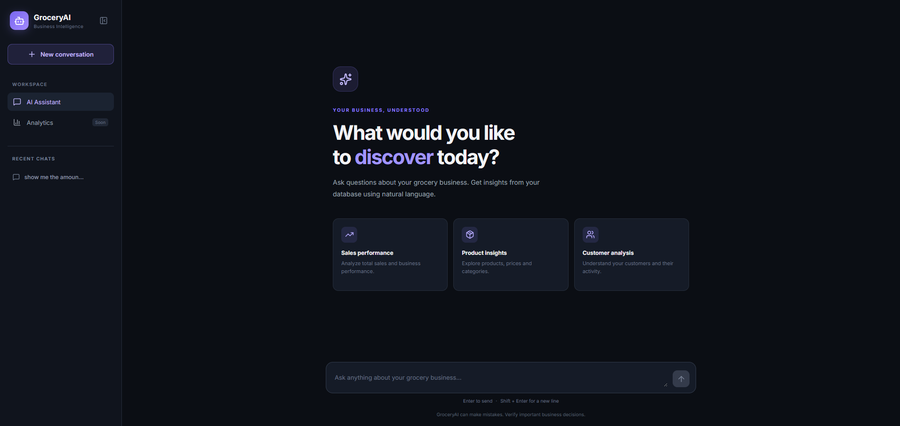
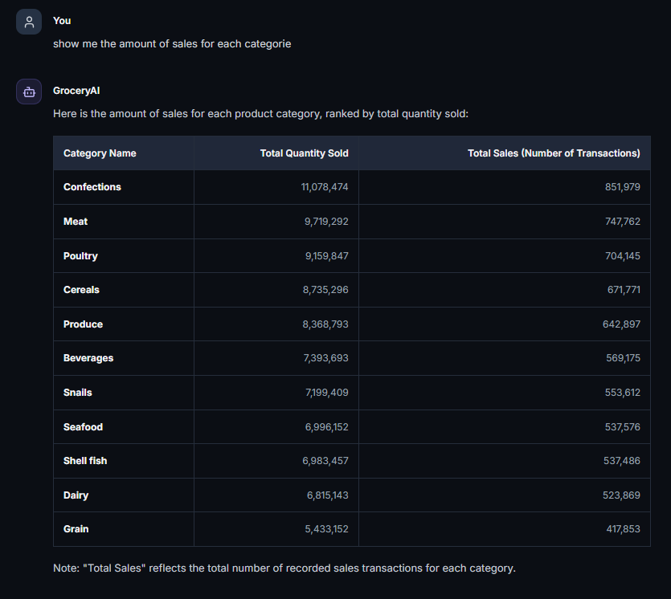
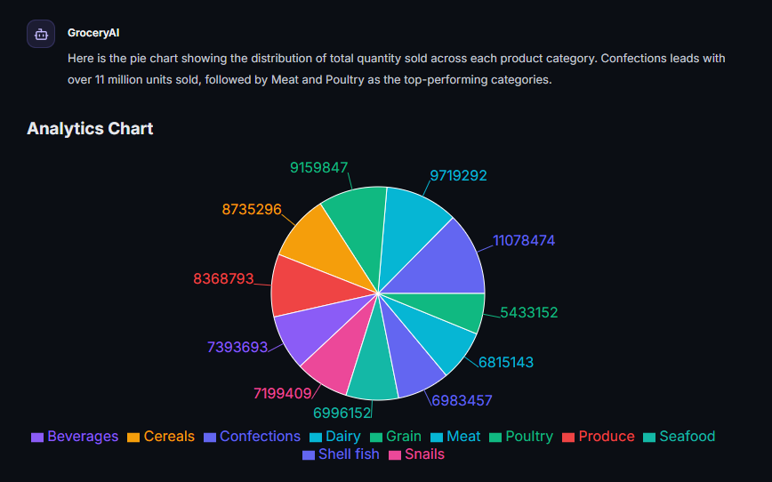

# GroceryAI

**AI-Powered Grocery Management and Analytics Platform**

## Overview

GroceryAI is an AI-powered platform designed to simplify access to grocery business data through natural language interaction.

Instead of writing SQL queries, users can simply ask questions in plain English. An AI agent interprets their requests, retrieves relevant data, performs analysis, and presents the results in an understandable way.

## Features

- **Natural Language Interaction** – Query business data using everyday language.
- **Data Analysis** – Retrieve and analyze information from the database.
- **Business Insights** – Generate useful statistics to support decision-making.
- **Data Visualization** – Present analytical results through charts and visual representations.
- **Database Integration** – Work with structured business data stored in PostgreSQL.

## Technologies

- Java & Spring Boot
- React
- PostgreSQL
- Google Gemini API
- Flyway
- Docker

## Goal

The goal of GroceryAI is to make business data more accessible and easier to understand, enabling users to explore information and gain insights without requiring SQL knowledge.

## Getting Started

1. Clone the repository.
2. Create a `.env` file based on `.env.example`.
3. Configure your database credentials and Gemini API key.
4. Run the application:

```bash
docker compose up --build
```

To stop the application:

```bash
docker compose down
```

## Database Setup

On the first launch, Docker creates a new PostgreSQL database.

- **Flyway** automatically creates the database schema using SQL migration files.
- **CSV Import:** Start PostgreSQL, then execute the Python script located in `database/import` to populate the database with the initial dataset.

Make sure to configure the database credentials before running the import script.

## Screenshots

### Dashboard


### AI Assistant


### Data Visualization
